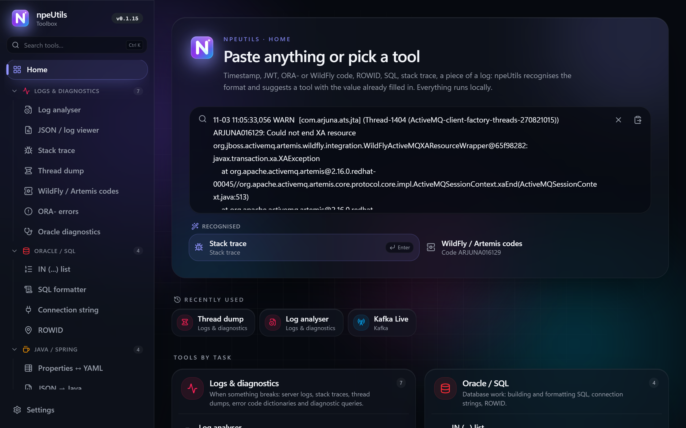
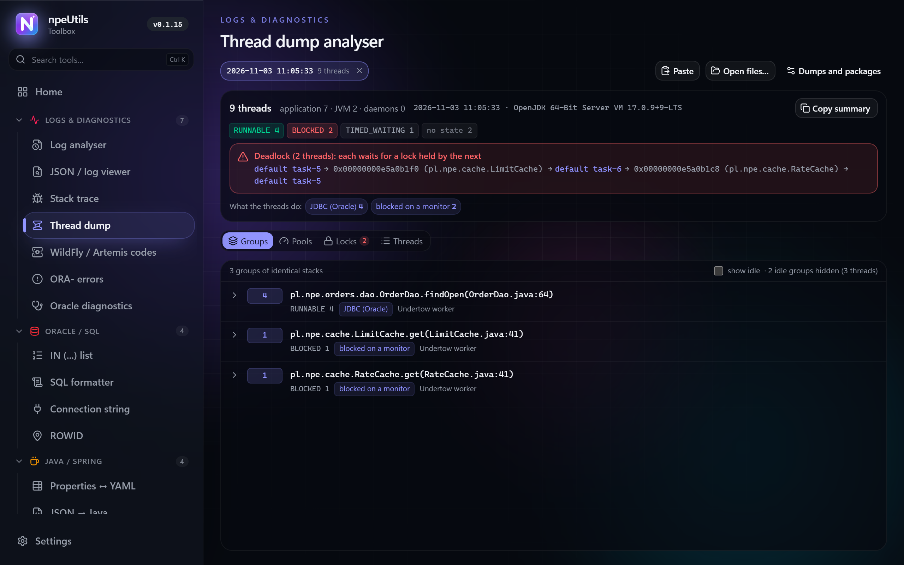
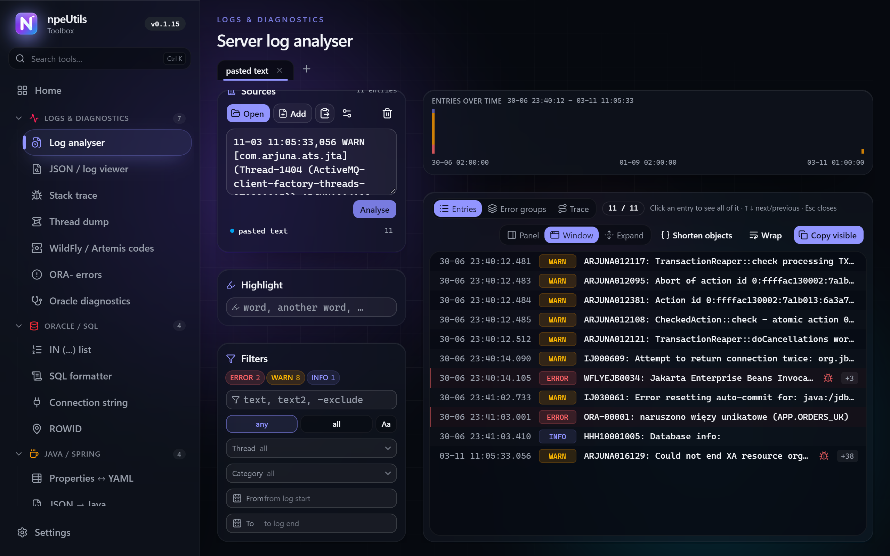
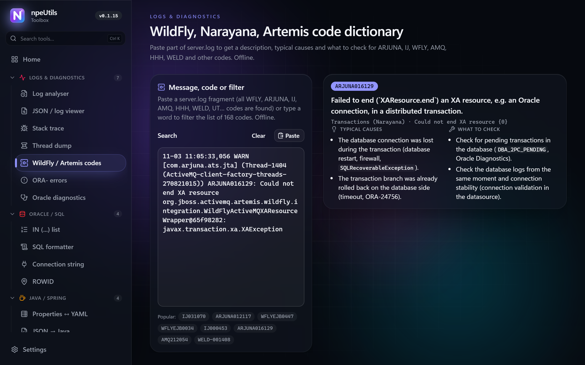
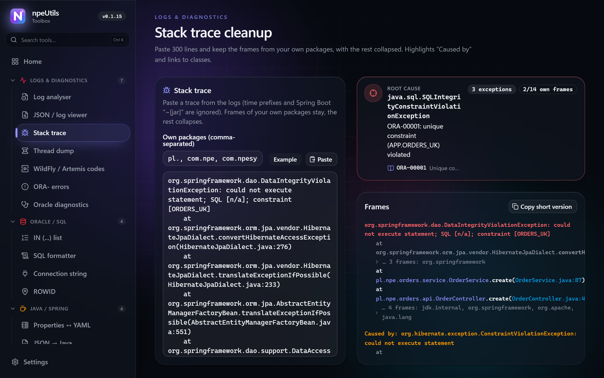
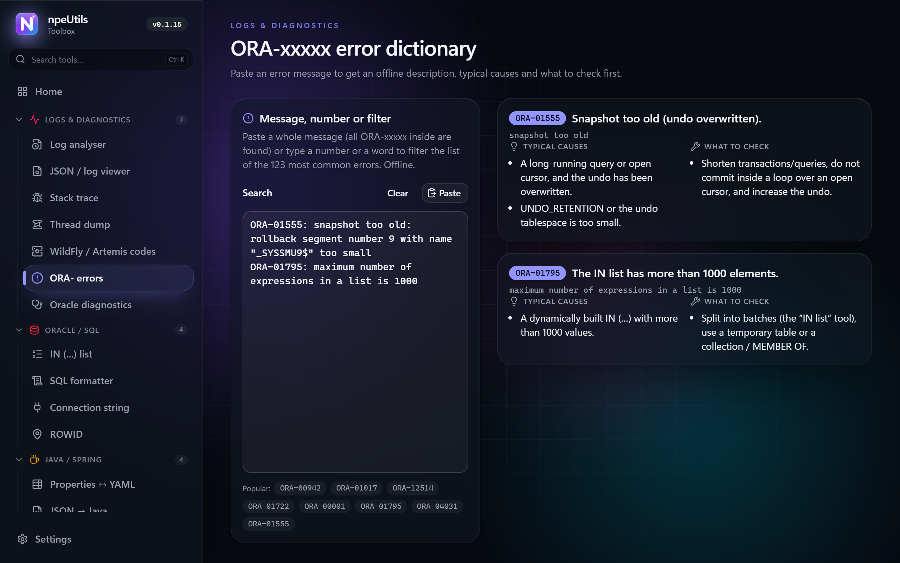
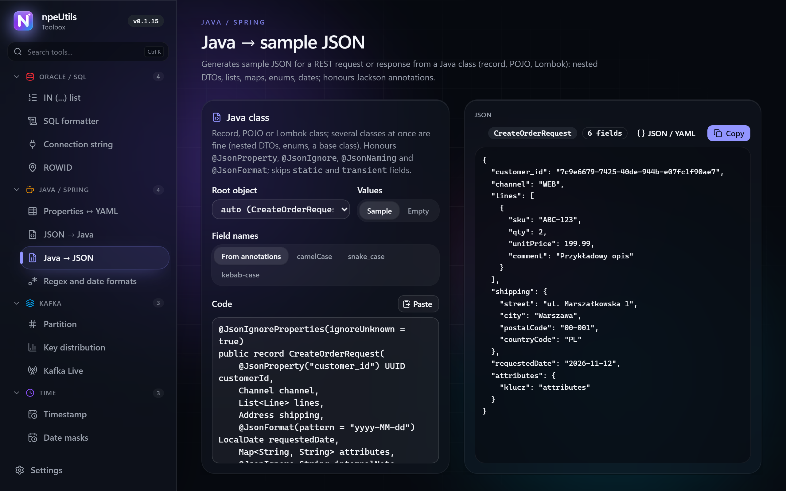
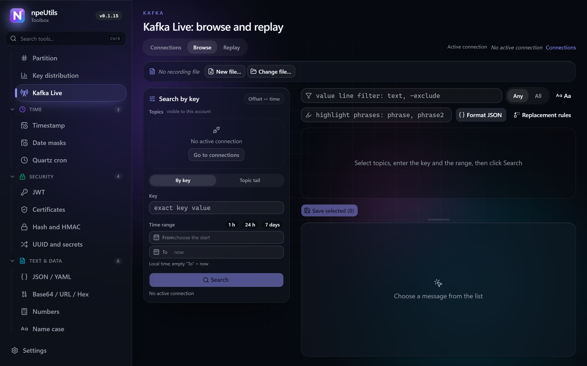
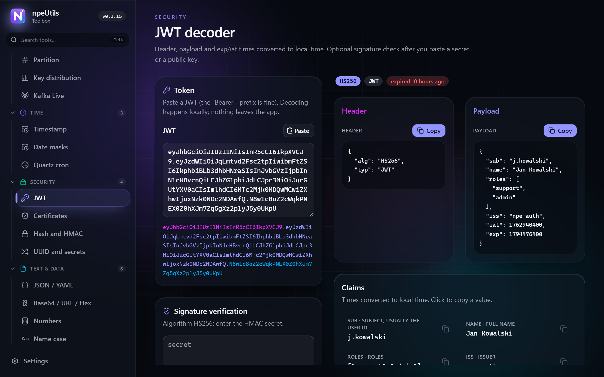
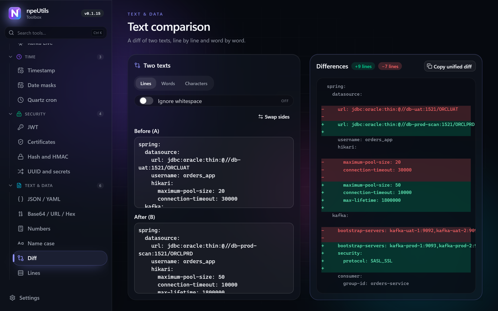

  

<h1 align="center">npeUtils</h1>

  <b>An offline desktop toolbox for people who keep Java / WildFly / Oracle / Kafka systems running.</b> 
  Paste anything, get the right tool with the answer already filled in. 3 MB. No account. No data ever leaves your machine.

  <a href="https://github.com/mderkowski82/npeUtils-releases/releases/latest"><b>⬇ Download for Windows</b></a>
  &nbsp;·&nbsp; <a href="#tools">Tools</a>
  &nbsp;·&nbsp; <a href="#privacy">Privacy</a>
  &nbsp;·&nbsp; <a href="#polski">Polski</a>

  

---

## Why

Support and maintenance work on enterprise Java means fifteen browser tabs: an epoch converter here, a JWT decoder there, an ORA- code in Google, a thread dump sent to an online analyser you were never allowed to send it to.

npeUtils puts the tools for that stack into one small window that works entirely offline. You paste whatever you have, the app detects what it is, and opens the right tool with the value already in place.

- **Paste anything.** The start page recognises a timestamp, JWT, UUID, ORA- code, WildFly / Narayana / Artemis code, ROWID, Quartz cron, Oracle connection string, SQL, JSON, Java class, stack trace, thread dump, log lines, properties file, Base64 or a list of values, and suggests the tools for it. `Ctrl+K` searches tools from anywhere.
- **Built for one stack.** Java / Spring / Jakarta EE, WildFly / JBoss, Oracle, Kafka. Not a generic "every developer" toolbox: it knows ROWIDs, `TO_CHAR` masks, IronJacamar pools, Narayana transaction codes, murmur2 partitions.
- **Local by design.** Logs, tokens, thread dumps and connection strings stay on your machine. See [Privacy](#privacy) for the complete list of network calls.
- **Small and fast.** Tauri 2 + Rust, system WebView2, no Electron. The installer is about 3 MB, the app starts instantly and lives in the system tray.
- **English and Polish UI**, light and dark theme, automatic signed updates.

## Who it is for

| You are | Typical pain | What you get |
| --- | --- | --- |
| **Java / Spring developer** | 400-line stack traces, DTOs to write from JSON, a regex that works in JS but not in Java | Stack trace cleanup with root cause, JSON ↔ Java (records / Lombok / Jackson annotations), Properties ↔ YAML, regex tester that flags Java-vs-JS differences, live `DateTimeFormatter` tester |
| **Helpdesk / 2nd-line support** | the ticket has an epoch and an `ORA-01555` or `WFLYEJB0034` and nobody knows what they mean | Timestamp both ways, offline dictionaries of 123 ORA- errors and 168 WildFly / Artemis codes with causes and "what to check", log analyser filtered by a customer ID |
| **Application admin / DevOps / SRE** | a 2 GB `server.log` inside a ZIP, a `jstack` dump, "is the server stuck on the JDBC pool?" | Log analyser (ZIP / GZ / TAR, DuckDB module for huge files), thread dump analyser with deadlocks and exhausted pools, certificate inspector, connection string with a port check |
| **Oracle DBA / developer** | 3 000 IDs for an `IN (...)`, a ROWID from a log, a `TO_CHAR` mask to port to Java | IN list in batches of 1 000 (ORA-01795), ROWID decoder, date mask converter, SQL formatter that fills Hibernate `?` parameters, 16 ready diagnostic queries |
| **Kafka / integration team** | "what arrived for customer X between 14:00 and 14:10, on which partition?", moving traffic from UAT to DEV | Kafka Live: search by key in a time range, live topic tail, offset ↔ time, record and replay messages; partition and key distribution calculators offline |

## Tools

31 tools in 7 groups. The list below is a summary; every tool shows its own description and options in the app.

### Logs & diagnostics

- **Thread dump** – paste or open dumps from `jstack`, `jcmd Thread.print` or `kill -3` (HotSpot JDK 6–25). Finds deadlocks, exhausted pools, threads stuck in the same place and who holds the lock others wait for. Tags what threads do: JDBC, IronJacamar / Hikari pool wait, Artemis, HornetQ, Kafka, HTTP. Several dumps at once show idle threads and CPU growth between dumps. *Copy summary* gives a Markdown table for a ticket.
- **Log analyser** – `server.log` from WildFly / JBoss, Spring Boot / Logback, log4j and custom patterns. Opens files, folders, ZIP (incl. ZIP64), GZ, TAR, TGZ and rotated `server.log.1.gz` straight from an archive. Splits multi-line entries (stack traces, JSON, XML), filters by level / thread / category / time, histogram, error groups, trace of one ID across many files and nodes. Files over 300 MB go through an optional DuckDB module downloaded on demand.
- **JSON / log viewer** – colouring, line filter by several words, live regex replacements.
- **Stack trace** – collapses framework frames, highlights your own packages, shows the root cause and a short version for a bug report.
- **WildFly / Artemis codes** – offline dictionary of 168 codes (ARJUNA, IJ, WFLY, AMQ, HHH, WELD, UT, Infinispan, RESTEasy, Elytron, JBAS) with description, typical causes and what to check. Paste a log fragment and every code in it is explained.
- **ORA- errors** – offline dictionary of the 123 most common Oracle errors with causes and first steps.
- **Oracle diagnostics** – 16 ready queries for locks, XA, slow SQL, space, INVALID objects (Polish only for now).

### Oracle / SQL

- **IN (...) list** – column of values → `'a','b'` or numbers, dedup, sort, batches of 1 000, optional full predicate with the column name.
- **SQL formatter** – PL/SQL dialect, fills `?` placeholders from Hibernate logs.
- **Connection string** – EZConnect ↔ TNS ↔ JDBC thin (service / SID, many hosts), `tnsnames.ora` entry, TCP port check.
- **ROWID** – decode and build extended ROWIDs, with helper queries.

### Java / Spring

- **Properties ↔ YAML** – Spring Boot configuration both ways.
- **JSON → Java** – record / POJO / Lombok with type inference and Jackson annotations.
- **Java → JSON** – sample request / response JSON from a DTO (several classes, enums, base class); honours `@JsonProperty`, `@JsonIgnore`, `@JsonNaming`, `@JsonFormat`; values picked by field name.
- **Regex and date formats** – regex tester that detects Java / JS differences, Java literal, snippet; `DateTimeFormatter` tester.

### Kafka

- **Kafka Live** – connect to brokers (no auth, SASL PLAIN, SCRAM-SHA-256/512, TLS with the Windows certificate store). Search messages by key in a time range on the partition computed from the key, tail a topic live, convert offset ↔ time, record selected messages from many topics into one file and replay them to another cluster with the original spacing. No consumer group, no offset commits, handles transaction markers.
- **Partition** – `murmur2(key) & 0x7fffffff % partitions`, like the default partitioner, tested against Kafka's reference vectors.
- **Key distribution** – list of keys → histogram per partition, skew, σ, CSV export.

### Time

- **Timestamp** – s / ms / µs / ns → local and UTC (ISO 8601, RFC 2822), live clock, date → ms.
- **Date masks** – Oracle `TO_CHAR` ↔ Java `DateTimeFormatter` with live preview.
- **Quartz cron** – 6–7 fields (`?`, `L`, `W`, `LW`, `#`, names), plain-language description, next runs.

### Security

- **JWT** – header, payload, claims with times, HS / RS / PS / ES signature check (Web Crypto, local).
- **Certificates** – PEM / DER: subject, issuer, validity, SAN, fingerprints.
- **Hash and HMAC** – MD5, SHA-1/256/384/512, CRC32 for text and files, compare with expected.
- **UUID and secrets** – v4 / v7 in bulk, inspection (time from v7), passwords and secrets.

### Text & data

- **JSON / YAML** – format, minify, convert, sort keys.
- **Base64 / URL / Hex / Unicode / HTML / binary** – with auto-detection when decoding.
- **Numbers** – dec / hex / bin / oct, two's complement, bit flags, IEC / SI sizes, chmod.
- **Name case** – snake / camel / Pascal / CONSTANT / kebab, Oracle columns → Java fields with templates.
- **Diff** – lines / words / characters, unified diff for a PR.
- **Lines** – natural sort, dedup, regex filter, prefix / suffix, numbering, CRLF / LF, BOM.

## Install

1. Download `npeUtils_<version>_x64-setup.exe` from the [latest release](https://github.com/mderkowski82/npeUtils-releases/releases/latest).
2. Run it. The installer is per-user, so no administrator rights are needed. Windows 10 / 11 x64; WebView2 is installed automatically if missing.
3. The app checks for updates on start and every hour, and installs one only after you click *Install now*. Installers are signed with [minisign](https://jedisct1.github.io/minisign/); the public key is embedded in the app, and the `.sig` file next to each installer lets you verify it yourself.

Good to know:

- Closing the window hides the app to the tray next to the clock. *Quit* in the tray menu closes it.
- Every version is valid for 30 days from its release; the app tells you a week ahead and installs the newer version with one click.
- Logs over 300 MB need the *Large log module* (DuckDB), downloaded from this repository on demand in Settings, or installed from a file on computers without internet access.

## Privacy

Everything runs locally. No account, no telemetry, no analytics. The only outbound connections are:

| Connection | When | To |
| --- | --- | --- |
| Update check (`latest.json`) | on start and every hour | github.com (this repository) |
| Large log module download | only when you click *Download* in Settings | github.com (this repository) |
| Version validity time check (HTTP `Date` header only) | on start and every hour | github.com, then microsoft.com |
| TCP port check | only when you click *Port* in Connection string | the host you typed |
| Kafka brokers | only in Kafka Live, to brokers you configured | your brokers |

Nothing you paste is ever sent anywhere. Kafka Live connection passwords are stored in the local app data folder encoded, not encrypted; use a dedicated read-only account where possible.

## Feedback

Bugs and ideas: [open an issue](https://github.com/mderkowski82/npeUtils-releases/issues). Say which tool, which version (Settings → Updates) and, if you can, paste the input that misbehaved (anonymised).

---

## Polski

**npeUtils to darmowy, działający offline zestaw narzędzi dla ludzi, którzy utrzymują systemy na stosie Java / WildFly / Oracle / Kafka.** Wklejasz cokolwiek (log, stack trace, zrzut wątków, kod ORA- lub WFLY, JWT, timestamp, cron, connection string), aplikacja rozpoznaje, co to jest, i otwiera właściwe narzędzie z gotowym wynikiem. Instalator ma 3 MB, nie ma konta ani telemetrii, nic nie wychodzi z komputera.

**Dla kogo**

- *Programista Java / Spring*: stack trace z root cause i zwiniętymi ramkami, JSON ↔ Java (record / Lombok / Jackson), Properties ↔ YAML, tester regex z różnicami Java / JS, `DateTimeFormatter` na żywo.
- *Helpdesk / 2. linia wsparcia*: słowniki 123 błędów ORA- i 168 kodów WildFly / Artemis z przyczynami i „co sprawdzić” po polsku, timestamp w obie strony, analizator logu z filtrem po identyfikatorze klienta.
- *Administrator / DevOps*: analizator `server.log` z ZIP-ów i rotowanych `.gz`, thread dump z deadlockami i wyczerpanymi pulami (Hikari, IronJacamar, Artemis), certyfikaty, connection string z testem portu.
- *DBA / developer Oracle*: lista IN po 1000, ROWID, maski `TO_CHAR` ↔ `DateTimeFormatter`, formatter SQL z podstawianiem `?` z logów Hibernate, 16 zapytań diagnostycznych.
- *Zespół Kafki*: Kafka Live (szukanie po kluczu w zakresie czasu, ogon topiku na żywo, offset ↔ czas, nagrywanie i odtwarzanie wiadomości), partycja i rozkład kluczy offline.

**Instalacja.** Pobierz `npeUtils_<wersja>_x64-setup.exe` z [najnowszego wydania](https://github.com/mderkowski82/npeUtils-releases/releases/latest) i uruchom. Instalacja jest per użytkownik, bez uprawnień administratora. Windows 10 / 11 x64. Aplikacja sama sprawdza aktualizacje i instaluje nową wersję dopiero po kliknięciu „Zainstaluj teraz”. Każda wersja jest ważna 30 dni od wydania; o końcu ważności aplikacja uprzedza tydzień wcześniej.

**Język.** Interfejs jest po polsku i po angielsku (Ustawienia → Język; domyślnie język systemu). Zamknięcie okna chowa aplikację do zasobnika przy zegarku; „Zakończ” w menu ikony ją zamyka.

**Prywatność.** Jedyne połączenia sieciowe to: sprawdzenie aktualizacji i pobranie modułu dużych logów (to repozytorium), odczyt czasu dla ważności wersji (nagłówek HTTP `Date`), test portu w Connection string (host, który wpiszesz) oraz brokery Kafki wskazane ręcznie w Kafka Live. Nic, co wklejasz, nie jest nigdzie wysyłane.

**Zgłoszenia.** Błędy i pomysły: [issues](https://github.com/mderkowski82/npeUtils-releases/issues). Podaj narzędzie, wersję (Ustawienia → Aktualizacje) i, jeśli możesz, zanonimizowane wejście, na którym coś poszło nie tak.
